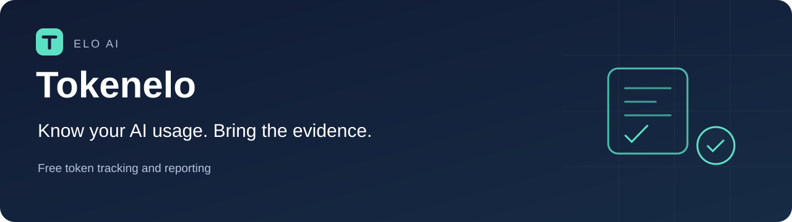

  

# Tokenelo

**Free AI token tracking and reporting for vendor accountability.**

Understand which tools and models were used, inspect the records behind a total, and bring a clear report into your next vendor conversation. Built by **Elo AI** for engineering, procurement, and FinOps teams.

**Website:** [tokenelo.eloai.co](https://tokenelo.eloai.co) · [Website source](site/index.html)

**Start here:** [What Tokenelo does](docs/product.md) · [Release status](docs/status.md) · [How to interpret counts](docs/data-accuracy.md) · [Build from source](docs/quick-start.md).

> **Internal alpha · source available under Apache 2.0 · no installers yet.** This repository contains the tracker source (`src/`, `test/`, `rates/`, `packaging/`, `native/`), public project documentation, artwork, repository tooling, a static marketing site in `site/`, and its separately deployed gateway source in `site-gateway/`. The source is licensed under [Apache 2.0](LICENSE). Installers and signed builds are not available, and no platform support is claimed. [Release and licensing details →](docs/licensing.md)

## Know the usage. Explain the number.

| Your question | What Tokenelo is being built to show |
| --- | --- |
| Where are our tokens going? | Usage by source, model, and session, with the recorded token components. |
| What is behind this total? | Drill-downs into the underlying records, selected range, and capture coverage. |
| How does this compare with a rate card? | Versioned **Standard API-equivalent** comparisons, with pricing assumptions and unpriced models visible. |
| What did we miss? | Coverage, freshness, diagnostics, and incomplete-count qualifications. |
| Can we take the evidence with us? | Local CSV and JSON reports, with explicit sharing and privacy guidance. |

**Recorded usage is evidence, not an invoice.** Subscription quotas, served tiers, negotiated rates, discounts, rounding, and uncaptured activity can differ from a vendor bill. Missing data must stay visible.

## Built for useful, free adoption

The tracker is designed to require no Tokenelo account, paid subscription or central upload. Local tracking and reporting must be useful on their own.

The implementation includes adapters for Claude Code, Codex, and configured local inference. Supported formats and coverage vary. Windows, macOS, and Linux are under verification; the [support matrix](docs/support-matrix.md) and [quick start](docs/quick-start.md) are release drafts, and no public platform support is claimed.

### The accountability workflow

1. Confirm the captured tools, time range, and coverage.
2. Inspect model and session records, including count qualifications.
3. Export a reviewed report and compare the same scope with vendor reporting.
4. Document assumptions and unresolved discrepancies before drawing a conclusion.

[Explore the product contract →](docs/product.md)

## Trust is part of the product

- **Local records.** Normalized counts and metadata are stored locally. Optional proxies process traffic in memory to obtain counters; configured fleet sharing is a separate choice.
- **Honest numbers.** Unknown, incomplete, unpriced, and measured zero have different meanings. API-equivalent comparisons do not establish actual spending or savings.
- **Careful sharing.** Metadata and raw exports can expose project identity and activity. Review them before sharing; public issues should use fabricated examples.
- **Visible limitations.** Passing internal tests does not establish complete capture, invoice reconciliation, public platform support, or an external security audit.

[Privacy model](docs/privacy.md) · [Security reporting](SECURITY.md) · [Interpreting the data](docs/data-accuracy.md)

## Follow or contribute

| Start here | Purpose |
| --- | --- |
| [Current status](docs/status.md) | Dated progress and what remains before release. |
| [Roadmap](docs/roadmap.md) | Acceptance work and proposed reporting improvements. |
| [FAQ](docs/faq.md) | Availability, licensing, billing comparisons, and privacy. |
| [Build from source](docs/quick-start.md) | Node.js setup, checks, and local use (a release draft). |
| [License](LICENSE) · [Third-party notices](THIRD_PARTY_NOTICES.md) | Apache 2.0 terms and candidate notices for the development dependency tree. |
| [Contributing](CONTRIBUTING.md) | Source and documentation changes, product feedback, and sanitized reproductions. |
| [Claude cloud workflow](docs/claude-cloud.md) | Work on public documentation with reproducible checks and a clear handoff. |
| [Issues](https://github.com/Schadenfroyd/Tokenelo/issues/new/choose) | Report a problem or propose a useful improvement. |
| [Private vulnerability report](https://github.com/Schadenfroyd/Tokenelo/security/advisories/new) | Report security findings confidentially. |

No public installer is available yet. Star or watch the repository to follow release progress. Vendor and product names identify sources; they do not imply endorsement.
