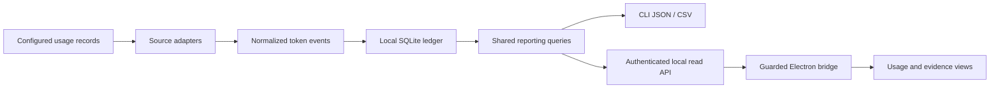

# Architecture — release draft

Tokenelo normalizes supported local usage records, stores them in a local ledger, and exposes the same reporting contract to the CLI and desktop UI.

## Main boundaries

- Collectors reconcile source-specific counters and record qualifications. They must not silently convert unsupported/missing counts into complete zeros.
- The core contract separates fresh input, cache creation/read, output, reasoning subsets, pricing and measurement status.
- SQLite persists normalized event metadata and provenance. Read queries and ingestion share the accounting contract.
- The local HTTP API is read-oriented and authenticated. Mutating import/reprice operations are CLI actions.
- Renderer data reaches the UI through the Electron preload/IPC bridge, not an unrestricted renderer-side filesystem or network API.
- Optional configured local proxies meter upstream traffic; optional fleet reporting has a separate listener/token and path-sharing controls.

## Measurement boundary

Token tracking/reporting is the whole product in this source edition: capture, normalized storage, API-equivalent price comparison, sessions, fleet aggregates and export. Any other valuation method is outside this edition; its database columns are kept unused and nullable so ledgers stay schema-compatible.

No ledger settlement, wallet, mining or reward mechanism is part of this tracker release. Future services consuming a reviewed measurement interface remain a separate design and licensing question.

## Engineering invariants

Keep missing data, known zero, failed reads and estimates distinct. Preserve capture/recorded-window context, stored pricing identity and calibration identity. Explain included subagents before asking readers to add totals. Treat identifiers, local paths and titles as sensitive metadata.
